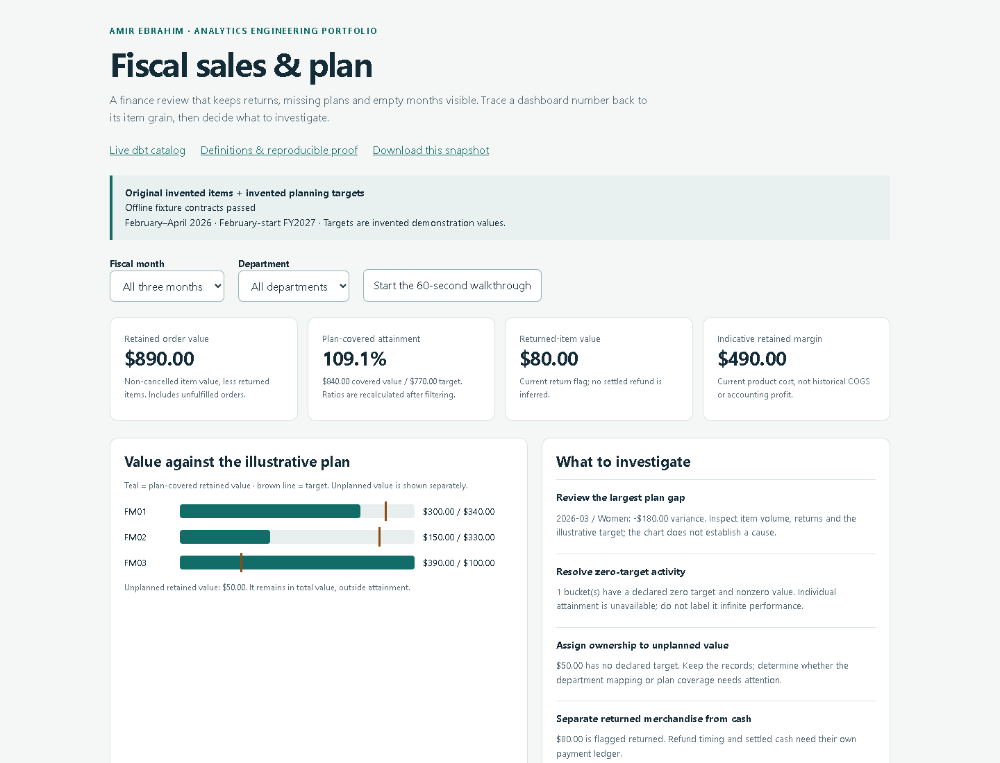
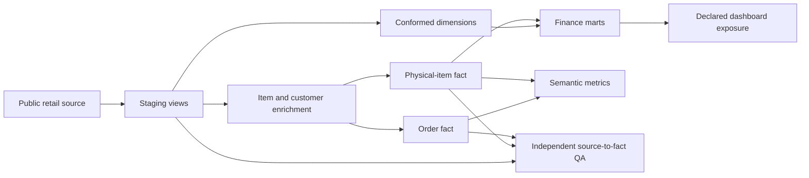

# Retail Analytics Platform: dbt, BigQuery and Business Contracts

A retail analytics platform for reviewing sales, returns and plan coverage without hiding missing plans and unmapped departments, or multiplying revenue through joins. Built with dbt, BigQuery and Airflow, with an interactive fiscal dashboard and independent reconciliation checks. Public sample data, invented offline records and invented targets; no employer code or data.

**Author:** [Amir Ebrahim](https://www.linkedin.com/in/amirebrahim/) | Senior Analytics Engineer, Austin, Texas

[](https://github.com/PharaohFresh/analytics-engineering-portfolio/actions/workflows/offline-ci.yml)
[](https://github.com/PharaohFresh/analytics-engineering-portfolio/actions/workflows/dbt-ci.yml)
[](https://github.com/PharaohFresh/analytics-engineering-portfolio/actions/workflows/airflow-ci.yml)

**Open the working proof:** [live dbt catalog](https://pharaohfresh.github.io/analytics-engineering-portfolio/) · [fiscal dashboard and walkthrough](https://pharaohfresh.github.io/analytics-engineering-portfolio/dashboard/) · [dashboard definitions and offline reproduction](case_studies/fiscal_attainment/README.md).



*Offline fixture shown above. The live view uses the public warehouse source with separately scaled invented targets and the same fiscal/coverage policy.*

## One worked decision

On the offline fixture shown above, plan-covered attainment is **109.1%**: $840.00 of plan-covered value against a $770.00 target, out of $890.00 total retained value. Read alone, that says the three months beat plan. The dashboard keeps three facts beside it:

| Bucket | Retained value | Plan | Why it matters |
|---|---|---|---|
| March / Women | $0.00 | $180.00 | Nothing retained against plan; the empty bucket stays visible instead of dropping out |
| April / Women | $300.00 | $0.00 (declared) | Over a third of the covered value sits against a zero plan; its own ratio is unavailable, not infinite |
| April / Unmapped | $50.00 | No plan | Value with no department or plan stays in the total but outside the ratio |

The decision is to review plan coverage before reporting the aggregate.

A dashboard can be wrong even when a pipeline succeeds. A creation-time watermark can miss a return; a customization join can repeat a sale; a session partition can omit a payment. This project makes those failure modes visible and tests the chosen contracts.

The warehouse uses Google's public `bigquery-public-data.thelook_ecommerce` sample dataset. Offline cases use original, invented records.

## A three-minute reviewer path

| Reader | Start here | What to look for |
|---|---|---|
| Recruiter or hiring manager | [The worked decision](#one-worked-decision) above, then the [interactive fiscal view](https://pharaohfresh.github.io/analytics-engineering-portfolio/dashboard/), [grain case](case_studies/grain_contracts/README.md) and [checkout case](case_studies/retail_telemetry/README.md) | A working stakeholder view, a reproducible result and a clear interpretation |
| Analytics engineer | [Item fact](models/marts/core/fct_order_items.sql), [finance marts](models/marts/finance/) and [tests](tests/) | Explicit grain, mutable-source handling and financial reconciliation |
| Data/platform engineer | [Independent contracts](scripts/qa_contracts.py), [orchestration](orchestration/README.md) and [regressions](offline_tests/) | Same-count corruption, target consistency, retries and rebuild policy |

## Capabilities demonstrated

| Capability | Executable evidence |
|---|---|
| Dimensional modeling | Staging, enrichment, order/item facts and customer/product/date/center dimensions |
| Business grain | Three orders, five physical units and seven customization records remain separate metrics |
| Mutable-source correctness | Older returns, tied timestamps, late arrivals and changed current product costs are reselected |
| Quality beyond counts | Twelve read-only checks compare keys, item and order values, and parent assignments against source; order rollups are checked against the item fact |
| Financial reporting | Composite mart grain checks and revenue/margin/unit/return-total reconciliation |
| Fiscal plan review | Empty-period coverage, zero/missing targets and independently reconciled month/department dashboard |
| Temporal event modeling | A session spanning two UTC partitions retains the next-day authorization |
| Governed consumption | Ten declared MetricFlow metrics, a product SCD-2 snapshot and a dashboard exposure |
| Operational consistency | Airflow build and QA share an explicit project, dataset and dbt target |

## Architecture and grain



- `fct_orders`: one row per `order_key`.
- `fct_order_items`: one row per `order_item_key`, one physical unit in this source.
- `mart_revenue_by_segment`: one row per `(traffic_source, country)`.
- `mart_product_category_margin`: one row per `(department, category)`.
- `snap_products`: separate SCD-2 product history. The fact joins the current product record.

The [exposures](models/marts/_exposures.yml) distinguish the declared revenue/margin consumer from the implemented fiscal dashboard. The fiscal view consumes its month/department mart and publishes after independent reconciliation.

## Run the offline examples first

Use Python 3.12 or newer in a virtual environment. No warehouse account is needed. From the repository root:

```bash
python -m pip install -r requirements-offline.txt
python -m pytest offline_tests -q
python -m case_studies.grain_contracts --output artifacts/grain
python -m case_studies.retail_telemetry --output artifacts/telemetry
```

[Run the fiscal dashboard](case_studies/fiscal_attainment/README.md) for its interactive walkthrough.

| Example | Reproduced result | Committed proof |
|---|---|---|
| Customization join | Naive join reports 85,000 cents; correct five-item contract reports 50,000 cents | [Grain report](case_studies/grain_contracts/example-report.json) |
| Missing catalog row | Inner join loses 12,000 cents; left join retains the unmapped valid sale | [Corrected query](case_studies/grain_contracts/fixtures/grain_safe.sql) |
| Cross-midnight checkout | Full session has one authorization; start-date-only filtering finds zero | [Telemetry report](case_studies/retail_telemetry/example-report.json) |
| Payment signals | Two recovered retries, one authorization-review candidate and one printer incident | [Interpretation and limits](case_studies/retail_telemetry/README.md) |

## Build the BigQuery warehouse

Use a separate Python 3.13 environment for the pinned warehouse dependencies. The build needs your own BigQuery project, dataset permissions and Application Default Credentials.

```bash
python -m pip install -r requirements-warehouse.txt
gcloud auth application-default login
mkdir -p ~/.dbt
cp profiles.yml.example ~/.dbt/profiles.yml
export DBT_TARGET=dev BQ_PROJECT=your-gcp-project BQ_DEV_DATASET=dbt_dev
dbt build --target dev --full-refresh
BQ_DATASET=dbt_dev python scripts/qa_audit.py
dbt docs generate --target dev
dbt docs serve
```

The dev and prod outputs read separate variables (`BQ_DEV_DATASET`, `BQ_PROD_DATASET`), so a dataset exported for development cannot redirect a production build. The product snapshot lands in `<dataset>_snapshots` for the selected output, for example `dbt_dev_snapshots`. The QA script requires both `BQ_PROJECT` and `BQ_DATASET`. Exit code `0` means all twelve contracts passed.

## Why the incremental strategy changed

`item_created_at > max(item_created_at)` only sees newly created records. It misses a return on an older item, a late-arriving item and a new item tied with the maximum timestamp. It also cannot refresh a current product cost/category lookup for an old item.

The fact now selects all current enriched source rows and uses dbt's keyed BigQuery merge. This keeps repeat runs idempotent and updates mutable values, at the cost of scanning the current source every run.

Merge does not remove rows that disappeared from source. Independent key coverage/count checks detect that state; a reviewed `dbt build --target dev --full-refresh` realigns the fact. The weekly DAG provides a scheduled rebuild mode. At production scale, choose a trustworthy update watermark, change log or bounded reprocessing policy and handle deletions explicitly.

`unit_cost`, category and margin reflect the current product record. Returns are a flag; sales totals use source sale prices rather than netting refunds.

## Quality and verification

- Generic dbt tests assert source/core keys and relationships.
- Six [singular finance tests](tests/) assert each composite grain, reconcile aggregate money, units and returns, and reconcile every bucket by key.
- Twelve [independent QA queries](scripts/qa_contracts.py) check row counts, unique/non-null keys, bidirectional source coverage, orphan items, prices, item state/parent/product enrichment, and order values/item rollups by stable key.
- [Offline regressions](offline_tests/test_warehouse_sql.py) exercise the rendered item/enrichment/order/finance SQL and singular tests on invented SQLite tables. They reproduce old returns, timestamp ties, late arrivals, changed costs/categories, missing source rows and same-count corruption, including offsetting price errors, swapped labels and wrong ratios that leave every total intact.
- [Configuration tests](offline_tests/test_configuration.py) render the profile template and compare default/overridden targets with the Airflow environment helper. Linux DagBag tests verify imports, dependencies, task environments, retry policy, the shared one-slot pool, one active run per DAG, QA priority and task timeouts.

The SQLite harness covers source selection and business contracts; credentialed CI is the warehouse engine check. See [Actions](https://github.com/PharaohFresh/analytics-engineering-portfolio/actions) for hosted BigQuery build/QA, fiscal readback and Linux Airflow results.

## CI, catalog and promotion

Three workflows separate portable contracts, Linux Airflow structure and credentialed BigQuery build/QA. BigQuery CI builds `dbt_ci` with a full refresh; runs are serialized because they share that dataset.

The [live dbt catalog](https://pharaohfresh.github.io/analytics-engineering-portfolio/) is published through GitHub Pages after a successful `main` build. The same deployment publishes the fiscal dashboard only after an independent item-to-mart reconciliation; a failed build or reconciliation leaves the previous deployment in place. Local `dbt docs serve` remains available after a warehouse build.

[Governance](GOVERNANCE.md) retains separate development/production targets and human review before production promotion.

## Repository map

```text
models/staging/       source contracts and typed views
models/intermediate/ item/customer enrichment
models/marts/        dimensions, facts, finance marts and exposure
models/semantic/     two semantic models and ten metric definitions
snapshots/           product SCD-2 history
scripts/             independent BigQuery QA and reusable query contracts
orchestration/       daily keyed merge, weekly rebuild and DagBag tests
offline_tests/       actual-SQL regressions and configuration/business checks
case_studies/        original grain and complete-session examples
runbooks/            model review, QA, mart creation and assisted delivery
```

Related projects: [governed lineage delivery](https://github.com/PharaohFresh/agentic-analytics-delivery), [query optimization](https://github.com/PharaohFresh/governed-query-optimizer) and [booking revenue reconciliation](https://github.com/PharaohFresh/revenue-reconciliation-pipeline). [MIT license](LICENSE).
